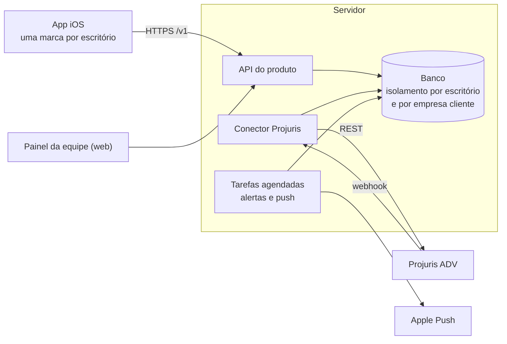

# API do produto — documentação

Referência · 23/11/2026. A API que o app do cliente consome. **O lado do app está pronto e
testado; o servidor ainda não existe.** Esta documentação é o contrato que o servidor precisa
cumprir e o desenho de como construí-lo.

## Por onde começar

| Documento | O quê | Para quem |
| --- | --- | --- |
| Este arquivo | Visão geral, convenções de fio, versão, estado de cada parte | Todos |
| [`autenticacao.md`](autenticacao.md) | Login por código, sessão, renovação, conta de revisão da Apple | Servidor, app |
| [`endpoints.md`](endpoints.md) | Cada rota: requisição, resposta, erros, exemplos | Servidor, app |
| [`modelos.md`](modelos.md) | O snapshot e cada objeto, campo a campo, com o que é obrigatório | Servidor |
| [`erros.md`](erros.md) | Corpo de erro, status, códigos estáveis, o que o app faz com cada um | Servidor, app |
| [`../regras-do-produto.md`](../regras-do-produto.md) | Publicação, estado do caso, 60/30/7, notificações — iguais no app e no servidor | Servidor, app, escritório |
| [`servidor.md`](servidor.md) | Arquitetura: banco, isolamento, conector, painel, tarefas, push, LGPD | Servidor |
| [`evolucao.md`](evolucao.md) | Rotas e campos planejados (v1.1), política de versão | Servidor, app |
| [`fonte-somente-leitura.md`](fonte-somente-leitura.md) | A API de teste do escritório (`/app/v1/processos`), usada hoje | App |
| [`openapi.yaml`](openapi.yaml) | O contrato v1 em OpenAPI 3.1, para gerar cliente, mock e testes | Servidor |

Documentos anteriores que esta referência resume e não substitui:
[`camada-de-servico.md`](../camada-de-servico.md) (o desenho e o porquê) e
[`conectar-projuris.md`](../conectar-projuris.md) (o roteiro do conector Projuris).

## O que é a API

Uma API HTTPS, JSON, **uma para todos os escritórios** (multi-inquilino). O app de cada escritório
fala só com ela; o sistema jurídico do escritório (Projuris ADV hoje) fica atrás dela, num conector
do servidor.



Três motivos para o app não falar com o Projuris direto, detalhados em
[`camada-de-servico.md`](../camada-de-servico.md):

1. A credencial do Projuris abre a carteira inteira do escritório. Dentro do app, qualquer cliente
   a extrai.
2. O Projuris não tem login de cliente final nem escopo por empresa cliente.
3. Tradução, aprovação e "exige o cliente?" não existem no Projuris. Moram no nosso banco.

## Estado de cada parte

| Parte | Estado | Onde |
| --- | --- | --- |
| Contrato v1 do lado do app (8 rotas) | Pronto e testado contra cliente falso | `AdvClient/Core/Services/Remote/`, `AdvClientTests/ServiceLayerTests.swift` |
| Camada de rede (erro, cache, nova tentativa, segurança) | Pronta e testada | `AdvClient/Core/Networking/`, `AdvClientTests/NetworkingTests.swift` |
| Fonte somente leitura de teste | Em uso pela marca Jordan Neves | `AdvClient/Core/Services/ReadOnly/` |
| Servidor, banco, conector, painel | **Não existe** | — |
| Rotas v1.1 (renovação, aparelhos, campos novos) | Desenhadas, nem no app nem no servidor | [`evolucao.md`](evolucao.md) |

Neste conjunto de documentos, **"o app exige"** quer dizer que o código já instalado depende daquilo:
mudar quebra o app. **"Proposto"** quer dizer desenho ainda aberto.

## Convenções de fio

### Endereço e versão

```
https://{host}/v1/...
```

- Só HTTPS, com certificado válido de autoridade pública e transparência de certificado. O app
  recusa `http://`, certificado autoassinado e certificado sem registro de CT, inclusive em teste.
- TLS 1.2 ou superior.
- O `host` de cada escritório vem do `Brand.json` da marca (`api.baseURL`). **Use um host por
  escritório** (`jordanneves.api.{domínio}`, todos apontando para o mesmo servidor). As duas rotas
  de login não levam token nem id de escritório, então o host é o único dado confiável para o
  servidor saber em qual lista de convidados procurar o e-mail — e o mesmo e-mail pode ter convite
  em dois escritórios. Depois do login, o token basta.
- A versão está no caminho. Mudança que quebra vira `/v2`, com `/v1` no ar até os apps instalados
  atualizarem. Ver [`evolucao.md`](evolucao.md).

### Redirecionamento

O app só segue redirecionamento **para o mesmo host, em HTTPS**. Qualquer outro `3xx` é tratado
como evento de segurança (`insecureTransport`) e a chamada falha. O servidor não deve redirecionar
rotas da API.

### Cabeçalhos que o app envia

| Cabeçalho | Valor | Observação |
| --- | --- | --- |
| `Authorization` | `Bearer {token}` | Em toda rota, exceto `POST /v1/auth/code` e `POST /v1/auth/session`. Token vencido no aparelho não é enviado. |
| `Accept` | `application/json` | |
| `Accept-Language` | `pt-BR` ou `en` | O idioma escolhido **no app**, não o do aparelho. Use para textos gerados no servidor (e-mail do código, por exemplo). |
| `Content-Type` | `application/json; charset=utf-8` ou o tipo do arquivo | O tipo do arquivo só no envio de documento. |
| `Cache-Control` | `no-store` | O app não usa cache HTTP; tem o próprio, criptografado. |
| `User-Agent` | `{bundle id}/{versão} (iOS {x.y})` | Ex.: `com.LumaRaySoftware.jordannevesadvogados/2.0 (iOS 18.1)`. Serve para métricas e para recusar versão antiga; não para autenticar. |

O app não envia cookie e ignora `Set-Cookie`.

### Cabeçalhos que o servidor deve enviar

| Cabeçalho | Quando | Para quê |
| --- | --- | --- |
| `Content-Type: application/json` | Sempre que houver corpo | O app só lê o corpo de erro se ele for JSON. |
| `X-Request-ID` | Sempre | O app guarda no log de diagnóstico; o suporte cruza com o log do servidor. `X-Correlation-ID` também é aceito. |
| `Retry-After` | Em `429` e, se fizer sentido, `503` | **Em segundos** (inteiro). O app não lê o formato de data HTTP. Acima de 5 s, o app desiste da nova tentativa automática e mostra o erro. |

### Corpo

- **JSON em `camelCase`**, exatamente como em [`modelos.md`](modelos.md). O app não converte
  `snake_case`.
- **Identificadores** são UUID em texto (`"11111111-1111-1111-1111-111111111111"`), maiúsculo ou
  minúsculo. Nunca o código do Projuris.
- **Datas** em ISO 8601 com fuso: `2026-11-14T17:30:00Z`. Fração de segundo é aceita
  (`2026-11-14T17:30:00.000Z`). Data sem hora (`2026-11-14`) é aceita e lida como meia-noite em
  `America/Sao_Paulo`. Milissegundos de época **não**: o conector converte os do Projuris.
- **Dinheiro** como texto decimal com ponto: `"84200.50"`. Nunca número (ponto flutuante perde
  centavos) nem vírgula. Moeda sempre BRL.
- **Enumerações** como texto. Valor que o app não conhece é tolerado, com regra própria por campo
  (ver [`modelos.md`](modelos.md)).
- **Campo opcional** pode vir ausente ou `null`; os dois valem o mesmo.
- **Campo a mais** é ignorado pelo app. Acrescentar campo não quebra nada.
- **Resposta vazia:** `204 No Content` ou `200` com corpo vazio.

### Isolamento

**Nenhuma rota recebe id de empresa ou de escritório.** O servidor sabe de quem é o token e devolve
só o que pertence àquela conta. Um id de caso, pendência ou documento de outra empresa deve
responder `404` — não `403`, para não confirmar que o recurso existe.

### Nova tentativa

O app repete automaticamente, até 3 tentativas no total, **só métodos idempotentes** (`GET`, `PUT`,
`DELETE`) e só em falha de infraestrutura: `429`, `5xx` (exceto `501`), tempo esgotado e conexão
perdida. Espera 0,5 s antes da segunda e 1 s antes da terceira, mais um ruído de até 0,25 s — ou
o `Retry-After`, se for de até 5 s.

`POST` **nunca** é repetido automaticamente: o cliente toca em "Tentar de novo". O servidor deve
tolerar o mesmo `POST` duas vezes sem duplicar efeito (ver cada rota em
[`endpoints.md`](endpoints.md) e a chave de idempotência em [`evolucao.md`](evolucao.md)).

### Tempo de resposta

| Chamada | Limite do app | Meta do servidor |
| --- | --- | --- |
| Envio de documento | 120 s | Responder logo depois de gravar o arquivo; repassar ao Projuris em segundo plano. |
| Ações (`POST`) | 30 s | Abaixo de 2 s |
| Leitura (`GET`) | 20 s | Snapshot abaixo de 1 s com até 100 casos |

O app falha rápido sem rede, sem esperar a conexão voltar.

## O que o app faz com a resposta

Resumo; o detalhe está em [`erros.md`](erros.md).

| Resposta | O app |
| --- | --- |
| `2xx` | Usa. O snapshot entra no cache criptografado do aparelho. |
| `401` | Apaga o token e o cache, volta para a tela de login. Em qualquer rota. |
| `403` | Mostra "não liberado para o seu acesso". **Não** derruba a sessão. |
| `404`, `409`, `422` | Mostra a frase do caso. Não repete. |
| `429`, `5xx`, sem rede | Repete se for idempotente; se não der, mostra o snapshot guardado (até 7 dias) **dizendo desde quando**. |
| JSON fora do contrato | Falha com frase genérica. Item malformado dentro de uma lista é descartado sozinho. |

O texto de erro do servidor (`detail`) **nunca aparece na tela**. O app ramifica pelo `code`.
