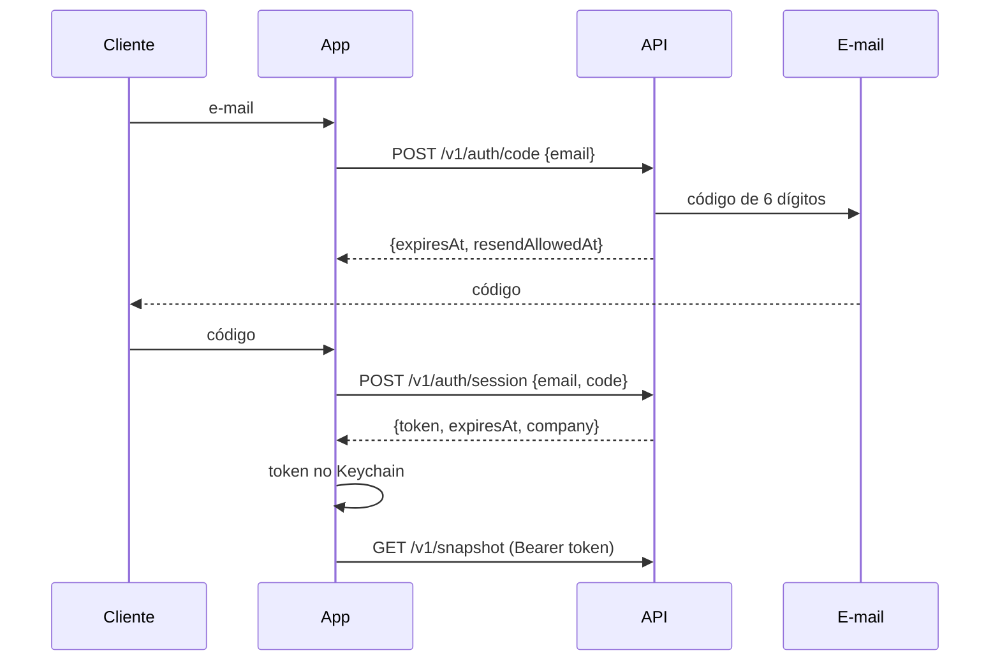

# Autenticação

Referência · 23/11/2026. Parte da [documentação da API](README.md).

## Como funciona

Sem senha. O cliente digita o e-mail que o escritório convidou, recebe um código de 6 dígitos e
troca o código por uma sessão. O Face ID só destrava o app no aparelho: **não autentica no
servidor**.



| Quem | Faz |
| --- | --- |
| App | Telas de e-mail e código; guarda o token no Keychain; Face ID; volta ao login em qualquer `401` |
| API | Gera, envia e confere o código; emite e revoga sessões; aceita só e-mails convidados; registra cada acesso |
| Serviço de e-mail transacional | Entrega o código, com remetente no domínio do escritório |
| Equipe do escritório, no painel | Convida pessoas e tira o acesso de quem saiu da empresa cliente |

## Qual escritório

As duas rotas de login não levam token. O servidor descobre o escritório pelo **host** da chamada
— por isso cada marca aponta o `api.baseURL` para um host próprio (ver
[README](README.md#endereço-e-versão)). Sem isso, um e-mail convidado por dois escritórios não
teria como saber qual sessão abrir.

## Pedir o código

`POST /v1/auth/code` — sem autenticação.

```json
{ "email": "financeiro@costalog.com.br" }
```

O app já manda o e-mail sem espaços e em minúsculas, e recusa no próprio aparelho o que não parece
e-mail. O servidor normaliza de novo.

**200**

```json
{
  "expiresAt": "2026-11-23T15:10:00Z",
  "resendAllowedAt": "2026-11-23T15:00:45Z"
}
```

| Campo | O app |
| --- | --- |
| `expiresAt` | Recusa o código no aparelho depois desta hora, sem chamar o servidor, e mostra "O código expirou". |
| `resendAllowedAt` | Mostra a contagem e acende "Reenviar código" nesta hora. |

O que o servidor deve fazer:

| Regra | Valor |
| --- | --- |
| Formato | 6 dígitos, aleatório criptográfico |
| Validade | 10 minutos |
| Reenvio | Depois de 45 segundos. Reenviar invalida o código anterior. |
| Uso | Uma vez só |
| Guarda | Só o hash, nunca o código em claro; nunca em log |
| Limite por e-mail | 5 códigos por hora (proposto) |
| Limite por IP | 20 pedidos por hora (proposto); IP de empresa atrás de NAT pode ter várias pessoas |
| E-mail | Sem nenhum dado do cliente além do código; assunto e texto no idioma de `Accept-Language` |

**Erros**

| Status | `code` | O app mostra |
| --- | --- | --- |
| 422 | `malformed_email` | "E-mail inválido" |
| 404 | `unknown_email` | "Este e-mail não está na lista de acessos do escritório." e o botão "Não recebi convite", que abre o WhatsApp do escritório |
| 429 | `too_many_requests` | "Muitas tentativas seguidas. Aguarde um instante e tente de novo." |

`unknown_email` revela se um e-mail foi convidado. É escolha de produto: o cliente sem convite
precisa saber que o problema é o convite, não a caixa de entrada. A defesa é o limite por IP e por
e-mail, não esconder a resposta.

## Abrir a sessão

`POST /v1/auth/session` — sem autenticação.

```json
{ "email": "financeiro@costalog.com.br", "code": "492718" }
```

O app manda só os dígitos (`"492-718"` digitado vira `"492718"`).

**200**

```json
{
  "token": "Zx8...opaco...",
  "expiresAt": "2026-12-23T15:02:10Z",
  "company": {
    "id": "0b7c1d3e-8f40-4a5e-9a51-6c2d7f3e9a10",
    "legalName": "Costa Log Transportes Ltda",
    "tradeName": "Costa Log",
    "cnpj": "14.902.336/0001-08",
    "userEmail": "financeiro@costalog.com.br"
  }
}
```

| Campo | Obrigatório | O app |
| --- | --- | --- |
| `token` | sim | Guarda no Keychain, só neste aparelho, fora de backup e de iCloud. Manda como `Bearer`. |
| `expiresAt` | sim | Para de mandar o token depois desta hora; a próxima chamada volta `401` e o cliente vai ao login. |
| `company.id` | sim | UUID estável. Vira o escopo do cache do aparelho: trocar de conta não lê o cache da outra. |
| `company.legalName` | sim | Razão social, no Perfil |
| `company.tradeName` | sim | Nome fantasia; vai na mensagem pronta do WhatsApp e nas iniciais do Perfil |
| `company.cnpj` | sim | CNPJ **ou CPF**. Com 11 dígitos o app trata a conta como pessoa física (textos, rótulos, "Pessoais" no lugar de "Societário"). Formatado ou só dígitos. |
| `company.userEmail` | sim | O e-mail de quem entrou |

**Erros**

| Status | `code` | O app mostra |
| --- | --- | --- |
| 422 | `invalid_code` | "Código incorreto. Tente novamente." |
| 422 | `code_expired` | "O código expirou. Peça um novo." |
| 404 | `unknown_email` | Mesma frase do pedido de código |
| 429 | `too_many_attempts` | "Muitas tentativas seguidas…" |

O app ramifica pelo `code`, não pelo status. Os status acima são a recomendação; `401` também
funcionaria para `invalid_code`, mas reservar `401` para "sessão inválida" deixa o log legível.

Regras do servidor:

- **5 tentativas por código.** Na quinta errada, o código morre e o cliente pede outro.
- Comparação em tempo constante.
- Cada sessão aberta vai para a trilha de acesso: quem, quando, IP, `User-Agent`.

## O token

| Item | Valor proposto |
| --- | --- |
| Formato | Opaco, 256 bits aleatórios em base64url. Não precisa ser JWT: só o servidor o lê. |
| Guarda no servidor | Hash (SHA-256), com conta, escritório, aparelho, criado em, último uso, vence em |
| Validade | 30 dias. O Face ID protege o aparelho no dia a dia; o código por e-mail a cada poucas horas afastaria o cliente. |
| Escopo | Uma pessoa, uma empresa cliente, um escritório |

Enquanto não existir renovação (v1.1, [`evolucao.md`](evolucao.md)), token vencido manda o cliente
de volta ao login — o comportamento seguro.

### Revogar

O token deixa de valer em qualquer destes casos, e a próxima chamada do app volta `401`:

- o cliente sai da conta (`DELETE /v1/auth/session`);
- a equipe tira o acesso da pessoa no painel (revoga todas as sessões dela);
- a empresa cliente deixa de ser cliente do escritório;
- o escritório deixa de usar o produto.

## Encerrar a sessão

`DELETE /v1/auth/session` — com o token. Responde `204`.

O app chama **antes** de apagar o token, para o servidor saber qual revogar. Se a chamada falhar
(sem rede, por exemplo), o app apaga o token e o cache mesmo assim: sair nunca depende do servidor.
Token já vencido ou revogado também deve responder `204`.

## Conta de revisão da Apple

O revisor da Apple não recebe o e-mail do código. Por marca, o servidor precisa de:

- um e-mail de revisão (ex.: `revisao@{domínio do escritório}`) com **código fixo**;
- ligado a uma conta com **dados fictícios**, nunca de cliente real;
- documentado nas notas para o revisor no App Store Connect.

O código fixo só vale para esse e-mail, e o e-mail só abre a conta fictícia.

## Decisões em aberto

1. **Uma pessoa em duas empresas.** Um contador que atende duas empresas clientes do mesmo
   escritório. A v1 devolve uma `company` por sessão. Saída provável: o servidor escolhe a primeira
   e a v1.1 ganha a troca de empresa.
2. **Validade do token.** 30 dias é proposta; o escritório pode preferir menos.
3. **Papéis por pessoa.** Hoje todas as pessoas de uma empresa veem tudo da empresa (o Perfil diz
   "Pessoas com acesso"). Papéis entram na v1.1, no servidor.
