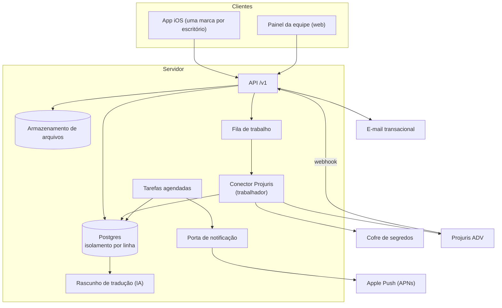
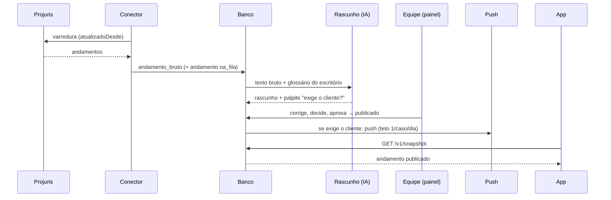

# Arquitetura do servidor

Desenho · 23/11/2026. Parte da [documentação da API](README.md). **Nada disto existe ainda.** É o
desenho que cumpre o contrato v1 e as [regras do produto](../regras-do-produto.md). Decisões ainda
abertas estão marcadas.

## Componentes



| Componente | Faz | Proposta |
| --- | --- | --- |
| API | As rotas `/v1` do app e as do painel; login; montagem do snapshot | Funções do Supabase (Deno) ou um serviço Node/TypeScript |
| Banco | Todos os dados, com isolamento por linha | Postgres do Supabase, região São Paulo |
| Armazenamento | Arquivos enviados e documentos publicados | Supabase Storage, privado, URL assinada |
| Fila | Trabalho que não pode travar a resposta ao app | `pgmq` ou tabela de tarefas |
| Conector | Fala com o Projuris; varredura e webhooks | Trabalhador separado da API |
| Tarefas agendadas | Varredura, alertas 60/30/7, lembretes, resumo semanal, limpeza | `pg_cron` |
| Rascunho de tradução | Primeira versão da explicação e palpite de "exige o cliente?" | Claude, com glossário por escritório |
| Porta de notificação | Envia push respeitando o teto | APNs hoje; Firebase quando houver Android |
| Cofre | Credenciais do Projuris, chaves de push | Supabase Vault |
| E-mail | Código de acesso | Serviço transacional, remetente no domínio do escritório |

A plataforma é decisão em aberto; Supabase é a recomendada no [plano da v2](../plano-v2.md)
porque já traz login por código de e-mail, isolamento por linha, armazenamento e tempo real (que a
conversa no caso vai usar).

## Multi-inquilino

**Um sistema para todos os escritórios**, separado por linha no banco. Nada de código por
escritório: diferença entre escritórios é configuração (capacidades, glossário, marca, provedor).
Se precisou de um `if escritorio == …`, falta configuração.

```
escritório ─┬─ empresa cliente ─┬─ pessoa (e-mail convidado)
            │                   ├─ caso ─┬─ andamento
            │                   │        └─ audiência
            │                   ├─ documento
            │                   ├─ pendência
            │                   └─ honorário
            ├─ membro da equipe
            └─ conexão com o provedor
```

### Isolamento

A regra mora **no banco**, não no código da API:

- Toda tabela de dado de cliente tem `escritorio_id` e `empresa_id`.
- Política de linha: a pessoa do app lê só linhas da `empresa_id` da sessão; o membro da equipe lê
  só linhas do `escritorio_id` dele.
- A API do app usa um papel de banco **sem** permissão de ignorar as políticas. Só o conector e as
  tarefas agendadas usam o papel de serviço.
- Teste obrigatório antes do piloto: duas empresas do mesmo escritório e dois escritórios; nenhum
  token lê nada do outro, por nenhuma rota.

### Do host ao escritório

Cada marca aponta para um host próprio (ver [README](README.md#endereço-e-versão)). A tabela
`escritorio_host` liga host a escritório. Nas rotas de login, o escritório vem do host; nas demais,
da sessão — e o servidor confere que os dois batem.

## Esquema do banco

Colunas principais. Toda tabela tem `id uuid`, `criado_em`, `atualizado_em`. Toda tabela de dado de
cliente tem `escritorio_id` e `empresa_id`.

### Inquilinos e acesso

| Tabela | Colunas | Observação |
| --- | --- | --- |
| `escritorio` | `nome`, `razao_social`, `fuso` (padrão `America/Sao_Paulo`), `capacidades` (json), `ativo` | |
| `escritorio_host` | `host` | Um ou mais por escritório |
| `escritorio_marca` | `bundle_id`, `team_id`, `apns_key_id`, `apns_chave_ref` (cofre), `versao_minima_app` | Uma por app publicado |
| `membro_equipe` | `email`, `nome`, `papel` (`socio`, `advogado`, `assistente`), `removido_em` | Login do painel |
| `empresa` | `nome_fantasia`, `razao_social`, `documento` (CNPJ ou CPF, só dígitos), `origem_provedor`, `origem_codigo` | Casada com o provedor pelo documento |
| `pessoa` | `email` (minúsculo), `nome`, `convidada_por`, `convidada_em`, `removida_em` | Único por (`escritorio_id`, `email`) |
| `codigo_acesso` | `pessoa_id`, `hash`, `vence_em`, `tentativas`, `usado_em`, `substituido_em` | Nunca o código em claro |
| `sessao` | `pessoa_id`, `token_hash`, `vence_em`, `revogada_em`, `ultimo_uso_em`, `user_agent`, `ip` | |
| `aparelho` | `pessoa_id`, `sessao_id`, `apns_token`, `plataforma`, `ambiente` (`sandbox`/`producao`), `desativado_em` | v1.1 |
| `conta_revisao` | `email`, `codigo_fixo_hash` | Uma por marca; ligada a empresa fictícia |

### Dados jurídicos

| Tabela | Colunas | Observação |
| --- | --- | --- |
| `caso` | `numero_cnj`, `titulo`, `area`, `vara`, `tribunal_sigla`, `segredo_justica`, `parte_contraria`, `valor_causa` (numeric), `risco`, `provisao`, `responsavel`, `aberto_em`, `encerrado_em`, `origem_*` | `titulo` em português claro é da equipe |
| `andamento_bruto` | `caso_id`, `data`, `texto`, `privado`, `origem_provedor`, `origem_codigo`, `recebido_em`, `hash` | **Nunca apagado nem editado.** É o histórico que permite trocar de provedor. |
| `andamento` | `bruto_id`, `titulo`, `traducao`, `exige_cliente`, `rascunho_ia`, `estado` (`na_fila`, `em_revisao`, `publicado`, `despublicado`, `descartado`), `aprovado_por`, `aprovado_em`, `publicado_em` | A versão que o cliente vê |
| `audiencia` | `caso_id`, `data`, `local`, `endereco`, `quem_comparece`, `confirmada_em`, `confirmada_por`, `origem_*` | |
| `audiencia_item` | `audiencia_id`, `texto`, `marcado`, `ordem` | "Leve com você" |
| `documento` | `caso_id`, `titulo`, `tipo`, `contraparte`, `vigencia_inicio`, `vencimento`, `aviso_ate`, `renova_sozinho`, `valor_mensal`, `versao`, `enviado_pelo_cliente`, `enviado_em`, `arquivado_em`, `arquivo_ref`, `hash_conteudo` | Restrição: `renova_sozinho` exige `aviso_ate` |
| `ponto_atencao` | `documento_id`, `clausula`, `titulo`, `detalhe`, `alerta`, `ordem` | |
| `pendencia` | `tipo`, `titulo`, `detalhe`, `vence_em`, `caso_id`, `documento_id`, `resolvida_em`, `resolvida_por` | |
| `honorario` | `referencia`, `valor`, `vence_em`, `pago_em`, `origem_*` | Do webhook de Receitas do Projuris |

Dinheiro em `numeric(14,2)`, nunca `float`. Datas em `timestamptz`.

### Operação

| Tabela | Para quê |
| --- | --- |
| `conexao_provedor` | Provedor, referência da credencial no cofre, último sucesso, último erro, ritmo atual |
| `varredura` | Cada execução: início, fim, processos vistos, andamentos novos, erro |
| `webhook_evento` | Id do evento, tipo, recebido em, processado em — para ignorar repetidos |
| `envio_push` | Pessoa, caso, motivo, enviado em, resultado — é o que aplica o teto |
| `evento_app` | Saída para o WhatsApp e outros rastros de uso |
| `trilha_acesso` | Quem leu ou mudou o quê, quando, de onde. Só inserção. |

## Montar o snapshot

`GET /v1/snapshot` é a rota mais chamada. Montagem:

1. Sessão → `pessoa` → `empresa_id`, `escritorio_id`.
2. Casos da empresa, com andamentos em estado `publicado` e a próxima audiência futura.
3. Documentos, pendências (abertas e resolvidas nos últimos 30 dias), honorários.
4. `capabilities` do escritório.
5. `syncedAt` = último sucesso da varredura **que cobriu esta empresa** — não a hora da resposta.
6. Converter para o formato de fio de [`modelos.md`](modelos.md): `camelCase`, dinheiro como texto,
   datas ISO 8601 em UTC, `""` em texto obrigatório desconhecido.
7. **Validar** contra o esquema antes de responder (ver
   [o que se perde](modelos.md#o-que-se-perde-quando-algo-vem-errado)). Objeto que não passa sai
   do snapshot **e** gera alerta — nunca silêncio.

Cache por empresa, invalidado a cada publicação, ação do cliente ou varredura com novidade.

## Conector

Um por provedor, todos atrás da mesma porta, devolvendo o modelo nosso. O roteiro do Projuris —
autenticação, mapeamento campo a campo, armadilhas — está em
[`conectar-projuris.md`](../conectar-projuris.md).

```
Conector
  empresa(documento)                  → Empresa?
  casos(empresa, alteradosDesde)      → [Caso]
  andamentos(caso, alteradosDesde)    → [AndamentoBruto]
  compromissos(caso)                  → [Compromisso]
  arquivos(caso)                      → [Arquivo]
  enviarArquivo(caso, bytes, nome)    → Arquivo
  concluirCompromisso(id)             → Compromisso
  capacidades                         → Capacidades
```

| Regra | Por quê |
| --- | --- |
| Credencial só no cofre; o conector a lê na hora | Abre a carteira inteira do escritório |
| Token do provedor reaproveitado até perto de vencer | O Projuris pede; e há limite por escritório |
| Varredura incremental por `atualizadoDesde` | O Projuris não tem webhook de andamento |
| Webhook de processo dispara a varredura daquele processo na hora | Menos atraso, menos chamadas |
| `429` → esperar `Retry-After` e baixar o ritmo daquele escritório | Não esgotar a cota que o próprio escritório usa |
| Andamento bruto gravado com origem e hash; repetido ignorado | Idempotência; histórico intacto |
| `privado: true` gravado, nunca publicado | Regra 1 |
| Datas do provedor convertidas em `America/Sao_Paulo` | Audiência uma hora errada é o bug clássico |
| Falha de varredura de um escritório não afeta os outros | Uma fila por escritório |

Frequência: uma vez por hora em horário comercial como ponto de partida (decisão em aberto com o
escritório). Meta do piloto: andamento novo no Projuris na fila de tradução em até 1 hora.

## Da fila ao cliente



O rascunho da IA nunca é publicado sozinho. O painel mostra o texto do tribunal ao lado do
rascunho, e só uma pessoa da equipe aprova. Despublicar tira o andamento do próximo snapshot.

## Painel da equipe

Web, só para membros do escritório. Não faz parte da API do app; usa rotas próprias sob
`/painel/v1`, com sessão própria.

| Tela | Faz |
| --- | --- |
| Fila de tradução | Original ao lado do rascunho; "exige o cliente?"; aprovar e ir ao próximo pelo teclado |
| Caso | Título claro, responsável, risco e provisão, audiência, checklist, pendências |
| Contratos | Cadastro com vencimento, renovação automática, prazo de aviso (obrigatório se renova), pontos de atenção |
| Documentos | Publicar para o cliente; conferir os enviados por ele |
| Pessoas | Convidar e remover pessoas de cada empresa; revogar sessões |
| Filas de atenção | Andamento sem explicação, caso parado, documento sem conferência, falha de sincronização |
| Escritório | Credencial do provedor (só gravação, nunca leitura), glossário, capacidades, conta de revisão |

| Papel | Pode |
| --- | --- |
| `socio` | Tudo, inclusive configuração e credenciais |
| `advogado` | Traduzir, aprovar, publicar, cadastrar contratos e pendências |
| `assistente` | Traduzir e deixar para aprovação; convidar pessoas |

## Tarefas agendadas

| Tarefa | Quando | Faz |
| --- | --- | --- |
| Varredura | De hora em hora, horário comercial | Puxa novidades de cada escritório |
| Rascunhos | A cada andamento novo | Pede o rascunho à IA |
| Alertas de contrato | Diariamente, 8h | Contratos que entraram em `urgent` geram push; em `decide` entram em "Precisa de você" |
| Audiências | Diariamente, 8h | Não confirmadas a 7 dias: push e pendência. Confirmadas: lembrete na véspera e 1 h antes. |
| Resumo semanal | Segunda, 8h | O que foi "para saber" na semana, por e-mail ou push único (decisão em aberto) |
| Limpeza | Diariamente | Códigos vencidos, sessões vencidas há 30 dias, aparelhos recusados pela Apple |
| Retenção | Mensalmente | Aplica a política de retenção (LGPD) |

Todas em `America/Sao_Paulo`.

## Notificações

- **Uma porta só** (`enviarNotificacao(pessoa, caso, motivo, texto)`) que aplica o teto de um por
  caso por dia antes de qualquer envio. Hoje fala com a APNs; com Android, com o Firebase.
- **Por marca:** a chave `.p8`, o Key ID e o Team ID da conta Apple em que a marca é publicada, e o
  bundle id. No cofre.
- **Texto sem sigilo:** "Há algo para você no processo 0012345-16…". Nunca o teor.
- **Abrir o caso certo:** o push leva `caseId` no corpo; o app abre o caso (v1.1).
- Token que a Apple recusa (`410 Unregistered`) é desativado.

## Arquivos

- Bucket privado, caminho com `escritorio_id/empresa_id/`. Política de linha também no
  armazenamento.
- Envio do cliente: conferir tipo pelos bytes, antivírus, gravar, avisar a equipe, repassar ao
  provedor em segundo plano.
- Abrir documento no app (v1.1): URL assinada de 5 minutos, gerada sob demanda. Nunca URL pública.

## Segurança

| Item | Como |
| --- | --- |
| Transporte | HTTPS com certificado de AC pública e registro de transparência; TLS 1.2+; HSTS |
| Pinning (app) | O app vai fixar o hash SPKI da chave do servidor **e** de uma chave reserva. Trocar de certificado sem trocar de chave não exige nova versão do app; trocar de chave sem a reserva derruba todos os apps. |
| Segredos | No cofre. Nunca em repositório, variável de ambiente de log ou e-mail. |
| Limite de chamadas | Por IP no login; por sessão nas demais (proposto: 60 por minuto) |
| Trilha | Toda leitura de dado de cliente pelo painel, toda ação do cliente, todo login |
| Cópia de segurança | Diária, com restauração testada a cada trimestre |
| Acesso de produção | Só pessoas nomeadas, com segundo fator |

## LGPD

| Item | Como |
| --- | --- |
| Papéis | O escritório é o controlador dos dados dos clientes dele; o produto é operador |
| Operadores do produto | Banco e armazenamento, e-mail transacional, IA do rascunho, monitoramento — cada um com contrato de tratamento de dados |
| Região | Dados em São Paulo; a IA recebe só o texto do andamento e o glossário, sem nome nem documento do cliente quando possível |
| Exportação | Por pessoa e por empresa, em JSON e PDF, a pedido do escritório |
| Exclusão | A pedido (o app leva o pedido ao escritório pelo WhatsApp). Processos e documentos ficam pelo prazo legal; o resto sai. |
| Retenção | Definida com o escritório; sessões e códigos saem em 30 dias; trilha de acesso fica 5 anos (proposto) |

## Observabilidade

- Todo pedido ganha um `X-Request-ID` (ou usa o que veio), que vai na resposta, no corpo de erro e
  em cada linha de log.
- **Nunca no log:** corpo de resposta, token, código de acesso, texto de andamento, CNPJ ou CPF.
- Métricas: latência por rota, taxa de erro por código, idade da última varredura por escritório,
  tamanho da fila de tradução, tempo da chegada à publicação.
- Alertas: varredura de um escritório sem sucesso há 3 horas; objeto do snapshot reprovado na
  validação; taxa de `5xx` acima de 1%; fila de tradução com item há mais de 24 horas.

## Ambientes

| Ambiente | Dados | Provedor | Quem usa |
| --- | --- | --- | --- |
| Desenvolvimento | Os dados de demonstração do app (empresa e pessoa física) como carga inicial | Projuris falso | Quem desenvolve |
| Homologação | Fictícios | Conta de homologação do Projuris | Equipe do escritório no piloto, TestFlight |
| Produção | Reais | Projuris de produção | Clientes |

Cada ambiente com host, banco, cofre e chaves próprios. Migrações versionadas no repositório,
aplicadas por esteira, nunca à mão.

## Testes do servidor

| Teste | Fonte |
| --- | --- |
| Contrato | O snapshot de `AdvClientTests/ServiceLayerTests.swift` e o exemplo de [`modelos.md`](modelos.md); o servidor gera respostas que o app decodifica sem descartar nada |
| Regras | `AdvClientTests/RulesTests.swift`, portado com os mesmos `now` |
| Isolamento | Duas empresas, dois escritórios, todas as rotas |
| Conector | Contra a conta de homologação: token reaproveitado, `429`, webhook repetido, datas às 14h30 |
| Publicação | Andamento `privado` e não aprovado nunca no snapshot |
| Teto de push | Três andamentos que exigem o cliente no mesmo caso e dia → um push |

## Escritório novo

O par do `scripts/nova-marca.py` no servidor, também por script:

1. Criar o escritório, o host e a marca.
2. Gravar a credencial do provedor no cofre e testar a conexão.
3. Casar as empresas clientes pelo CNPJ ou CPF.
4. Cadastrar o glossário e as capacidades.
5. Criar a conta de revisão da Apple com dados fictícios.
6. Convidar a equipe do escritório para o painel.
