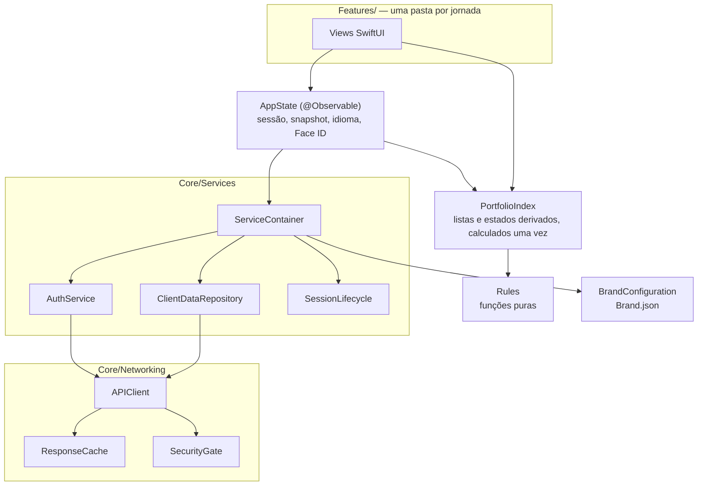

# Arquitetura do app

Referência · 23/11/2026. Parte da [documentação do app](README.md).

## Camadas



| Camada | Pasta | Regra |
| --- | --- | --- |
| Telas | `AdvClient/Features/` | Só leem `AppState` e o índice. Nunca montam requisição, nunca reimplementam regra. |
| Estado | `AdvClient/AppState.swift` | Um objeto observável para o app inteiro |
| Derivados | `AdvClient/Core/PortfolioIndex.swift` | Tudo o que as telas derivam do snapshot |
| Regras | `AdvClient/Core/Rules.swift` | Funções puras sobre um `now` recebido ([regras](../regras-do-produto.md)) |
| Serviços | `AdvClient/Core/Services/` | De onde vêm os dados: demonstração, API, fonte de teste |
| Rede | `AdvClient/Core/Networking/` | O único caminho para a rede ([detalhes](rede-e-seguranca.md)) |
| Marca | `AdvClient/Branding/` | `BrandConfiguration`, `Theme`, componentes e estilos |
| Segurança | `AdvClient/Core/Security/` | Keychain, Face ID, detecção de aparelho comprometido |

## Modelo de domínio

Em `AdvClient/Core/Models.swift`. É o que as telas usam; o formato de fio da API fica separado em
`Services/Remote/DTO/`, para o JSON poder mudar sem mexer em tela.

| Tipo | O quê |
| --- | --- |
| `Company` | A conta: empresa (CNPJ) ou pessoa física (CPF, 11 dígitos → `isPersonal`) |
| `LegalCase` | Processo, com `movements` e `hearing` |
| `CaseMovement` | Andamento: texto oficial, título, tradução, exige o cliente, aprovação, publicação |
| `Hearing`, `ChecklistItem` | Audiência e o "leve com você" |
| `ClientDocument`, `AttentionPoint` | Documento ou contrato, com prazos e cláusulas marcadas |
| `Pendency` | O que exige o cliente: audiência, decisão de contrato, documento pedido |
| `Invoice` | Honorários |
| `ClientSnapshot` | Tudo acima de uma vez, mais `lastSyncedAt` e `capabilities` |

## Estado: `AppState`

Um `@Observable @MainActor` injetado no ambiente pela raiz. Guarda:

| O quê | Onde persiste |
| --- | --- |
| Empresa da sessão, "entrou", Face ID ligado, já perguntou do Face ID | Keychain (só este aparelho) |
| Token da sessão na API | Keychain, via `SessionTokenStore` |
| Idioma escolhido, já viu as telas de apresentação | `UserDefaults` |
| Snapshot e índice | Memória (o snapshot também fica no cache criptografado da rede) |
| Andamentos lidos | Memória; volta a zero ao fechar o app |

Em instalação nova (`UserDefaults` vazio), o app apaga do Keychain qualquer sessão de uma instalação
anterior — o Keychain sobrevive à desinstalação, e uma pessoa nova não pode herdar a conta antiga.

### Fases do lançamento

`AppState.phase` decide a árvore da raiz (`RootView` → `LaunchFlow`):

```
splash → onboarding (só na primeira vez) → signIn → ready (abas)
```

### Atualizar dados

`refresh()` pede o snapshot ao repositório. Quem pede durante uma busca espera por ela (o login e a
primeira tela pediam juntos). Resultado:

- sucesso → `apply(snapshot)` recalcula o `PortfolioIndex`;
- falha → `loadFailed = true`; as telas mostram o aviso com a data do que está na tela e "Tentar de
  novo";
- antes da primeira resposta → `isAwaitingFirstLoad`, as telas mostram carregamento, não "nenhum
  caso".

Quando o snapshot é pedido: depois do login, ao abrir as abas, ao puxar para atualizar no Início,
em Casos e em Documentos, e no "Tentar de novo" do aviso de falha. Ao voltar ao primeiro plano, o
índice é recalculado (prazos dependem do dia) e o ambiente é rechecado; o snapshot **não** é
pedido de novo sozinho — com o servidor no ar, vale pedir quando a volta passar de alguns minutos.

## Derivados: `PortfolioIndex`

Calculado **uma vez por snapshot**, não a cada leitura. Antes eram propriedades computadas do
`AppState`, que refiltravam e reordenavam várias vezes por atualização de tela.

| Derivado | Usado em |
| --- | --- |
| `openCasesByUrgency`, `closedCasesByUrgency`, `allCasesByUrgency` | Lista de casos (ordem: exige você, prazo próximo, em dia, com o tribunal; depois o mais recente) |
| `casesRequiringClient`, `otherOpenCases` | Painel |
| `position` | Barra de posição jurídica |
| `state(of:)`, `nextDeadline(for:)` | Cartões e detalhe |
| `contracts`, `documentsNeedingAttention`, `contractAlert(for:)` | Documentos e painel |
| `openPendencies`, `informationalMovements` | Notificações |
| `unreadCount(excluding:)` | Selo do sino |
| `nextInvoice` | Perfil |

## Serviços

`ServiceContainer` é a raiz de composição — o único lugar que sabe de onde vêm os dados. O
`AppState` recebe um e fala só com os três protocolos.

| Protocolo | Faz |
| --- | --- |
| `AuthService` | `requestCode(email:)`, `verify(code:challenge:)`, `signOut()` |
| `ClientDataRepository` | `snapshot`, `confirmHearing`, `resolvePendency`, `upload`, `recordWhatsAppHandoff` |
| `SessionLifecycle` | `didSignIn` (escopo do cache), `didSignOut` (apaga cache e token), `willEnterForeground` (rechecagem do ambiente) |

| Montagem | Auth | Repositório | Quando |
| --- | --- | --- | --- |
| `.demo()` | `MockAuthService` | `MockClientRepository` | `"mode": "demo"`, prévias, rotas de captura |
| `.remote()` | `RemoteAuthService` | `RemoteClientRepository` | `"mode": "remote"` |
| `.readOnly()` | `MockAuthService` | `ReadOnlyCasesRepository` | `"mode": "readonly"` |
| `.unavailable(erro)` | falha | falha | `remote` com URL inválida, `readonly` sem chave |

As ações devolvem o snapshot inteiro já atualizado; o `AppState` só aplica.

### Capacidades

`ProviderCapabilities { documents, uploads }` vem no snapshot. Com `documents: false`, somem a aba
Documentos, os contratos do painel e o "Ver todos"; com `uploads: false`, some o botão de envio. As
telas escondem o que não existe em vez de mostrar botão que falha.

## Navegação

- `MainTabView` com cinco abas (`MainTab`): Início, Casos, Documentos, Contato, Perfil. A aba
  Documentos só existe com `capabilities.documents`.
- Cada aba tem a própria `NavigationStack` com a barra do sistema (título grande, gesto de voltar).
- Destinos tipados em `AppRoute`: `.legalCase(id)`, `.document(id)`, `.movement(caseID:movementID:)`,
  `.notifications`. Cada aba registra os destinos uma vez (`appRouteDestinations()`); qualquer tela
  empilha com `NavigationLink(value:)`.
- Uma pendência sabe para onde leva (`AppRoute(pendency:)`); sem destino, a linha não é tocável.
- Folhas (`sheet`) para a audiência e o envio de arquivo.

## Idioma

Português (fonte) e inglês, em `Resources/Localizable.xcstrings` (256 chaves) e
`InfoPlist.xcstrings`. O app segue o idioma do aparelho na primeira vez e oferece a troca no Perfil.

A troca vale para tudo porque:

- a raiz aplica `.environment(\.locale, …)`;
- texto gerado fora do SwiftUI passa por `Format.string(_:)`, que resolve contra `Format.uiLocale` —
  `String(localized:)` sozinho seguiria o idioma do aparelho;
- datas, horas e dinheiro usam `Format.date`, `Format.dateTime`, `Format.money`, no idioma do app e
  no fuso do escritório (`America/Sao_Paulo`); a moeda é sempre BRL;
- o cabeçalho `Accept-Language` das chamadas leva o idioma do app.

Texto que muda por escritório **e** por idioma vem do `Brand.json` como `BrandText`
([`white-label.md`](white-label.md)).

## Visual

- **Tokens** em `Branding/Theme.swift`: cores da marca vêm do catálogo de assets da marca
  (`BrandPrimary`, `BrandCard`…); verde, âmbar e vermelho semânticos ficam no código.
- **Tipografia** com Dynamic Type: cada tamanho do protótipo escolhe o estilo de texto do sistema
  mais próximo e acompanha a preferência do aparelho. Em tamanhos de acessibilidade, cartões e
  linhas reorganizam o selo.
- **Componentes** em `Branding/Components/`, um por arquivo: `CaseCard`, `AppListRow`,
  `StatePill`, `TimelineRow`, `KeyValueRow`, `EmptyStateView`, `WhatsAppButton`…
- **Estilos** em `Branding/Styles/`: botão primário, superfície de cartão, retorno ao toque,
  checklist.
- Área de toque mínima de 44 pt, inclusive em botões de texto.
- Tema claro travado (`.preferredColorScheme(.light)`) até a paleta escura existir.

## Testes

Em `AdvClientTests/`, com Swift Testing, rodando na marca `Referencia` (nunca depende do visual de
um cliente). O módulo se chama `AdvClient` em toda marca, então `@testable import AdvClient` vale
para qualquer target.

| Suíte | Testes | Cobre |
| --- | ---: | --- |
| `RulesTests` | 39 | Publicação, urgência, 60/30/7, estado do caso, posição, teto de push |
| `NetworkingTests` | 49 | Erros, cache, nova tentativa, redirecionamento, log redigido, portaria do ambiente |
| `FormatAndLinkTests` | 39 | Número CNJ, datas e dinheiro nos dois idiomas, link do WhatsApp, `.ics` |
| `DemoDatasetTests` | 14 | Os dois conjuntos de demonstração e o titular da conta |
| `ReadOnlySourceTests` | 13 | Fonte somente leitura: configuração, mapeamento, falhas |
| `ServiceLayerTests` | 12 | Contrato v1: snapshot, tolerância, rotas, login, saída |
| `PortfolioIndexTests` | 8 | Derivados e não lidos |
