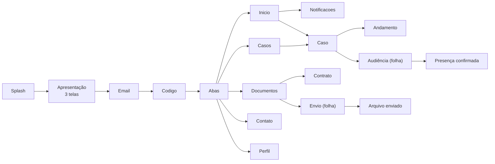

# Telas e jornadas

Referência · 23/11/2026. Parte da [documentação do app](README.md). Os textos citados são os de
pt-BR; todos existem também em inglês. Em conta de pessoa física, os textos que falam de "sua
empresa" mudam para "você".

Cada tela pode ser aberta direto num build de Debug pela rota de captura entre parênteses
([`desenvolvimento.md`](desenvolvimento.md#capturas-de-tela)).

## Mapa

## Entrada — `Features/Onboarding/`

### Abertura

A marca gráfica, a razão social e a frase de apresentação do escritório sobre a cor da marca, por
um instante. Só na abertura a frio.

### Apresentação (`onboarding`)

Três telas, só na primeira vez. "Pular" no topo; "Continuar" e, na última, "Acessar minha conta".

| # | Título | Ideia |
| --- | --- | --- |
| 1 | "Você vê o que exige você. O resto fica em segundo plano." | Triagem: Exige você, Com o tribunal, Em dia |
| 2 | "Dúvida? Um toque e você está no WhatsApp." | A mensagem já vai escrita, com o número do processo |
| 3 | "Seus contratos, com data de validade visível." | Vencendo em 60 dias, renovação automática |

### E-mail (`signIn`)

"Use o e-mail que recebeu o convite do escritório." Campo de e-mail, "Receber código", e a nota
"Sem senha para memorizar". Embaixo, "Não recebi convite" abre o WhatsApp do escritório com a
mensagem pronta.

Erros no próprio campo: e-mail malformado, e-mail fora da lista de acessos.

### Código (`code`)

Seis caixas de dígito (aceita colar e o preenchimento automático do iOS), "Confirmar", e
"Reenviar código" com contagem regressiva — acende 45 s depois do envio. O código vale 10 minutos.
Erros: código incorreto, código expirado. Voltar e arrastar da borda são os do sistema.

### Face ID

Depois do primeiro login, já nas abas, o app oferece proteger a conta com Face ID ("Agora não"
pula). Ligado, o app pede o Face ID ao voltar do segundo plano.

## Início — `Features/Home/` (`home`)

O painel. Responde "preciso fazer algo?" antes de qualquer outra coisa.

| Bloco | Mostra |
| --- | --- |
| Sino (barra) | Selo com pendências abertas + andamentos "para saber" recentes não abertos |
| Posição jurídica | Barra proporcional dos casos abertos: Exige você, Prazo próximo, Em dia; com legenda e contagens |
| Exige você | Só aparece se houver: casos em `requiresYou`, do prazo mais próximo ao mais distante |
| Seus casos | Os demais casos abertos; "Ver todos" leva à aba Casos |
| Contratos vencendo | Os que estão em alerta; "Ver todos" leva a Documentos (só com documentos ligados) |
| Rodapé | "Atualizado em …" com a data da última sincronização |

Estados: carregando antes da primeira resposta; aviso de falha no topo com a data dos dados e
"Tentar de novo"; vazio ("Nenhum caso ativo — quando o escritório abrir um processo para a sua
empresa, ele aparece aqui"). Puxar para atualizar.

### Notificações (`notifications`)

| Seção | Conteúdo |
| --- | --- |
| Exige você | Pendências abertas, pelo vencimento; cada uma leva ao caso ou ao documento |
| Para saber | Os 8 andamentos informativos mais recentes, marcados "nada a fazer"; os não abertos aparecem destacados |

Nota no rodapé: "Só o que exige você gera aviso no aparelho. O resto vem em um resumo semanal."
Vazio: "Nada pendente — você está em dia".

## Casos — `Features/Cases/`

### Lista (`cases`)

"Meus casos", com filtro Ativos / Encerrados / Todos. Cada cartão (`CaseCard`): título, número CNJ,
sigla do tribunal, área, selo de estado (Exige você, Prazo próximo, Com o tribunal, Em dia) e a
última atualização. Ordem: o que pede o cliente primeiro. Puxar para atualizar.

### Detalhe do caso (`caseDetail`)

| Bloco | Mostra |
| --- | --- |
| Cabeçalho | Título, número, estado |
| Seu próximo passo | Se há audiência não confirmada: "Confirmar presença na audiência", com data e contagem |
| Presença confirmada | Se já confirmou |
| Fatos | Parte contrária, sua posição, classe, vara, valor da causa, risco estimado com provisão, responsável — cada linha só aparece se o dado existe |
| Linha do tempo | Andamentos publicados, do mais novo ao mais antigo; cada um leva ao detalhe |
| Perguntar no WhatsApp | Mensagem com empresa, número e título do caso |

Estados da linha do tempo:

- vazia: "Sem andamentos publicados — assim que houver movimentação, o escritório publica aqui com
  a explicação";
- só atividade do tribunal (fonte de teste): a data e a origem da última movimentação, e "o texto do
  tribunal aparece aqui depois que o escritório o explicar";
- segredo de justiça (`sealedCase`): selo e "Linha do tempo indisponível", com a explicação de por
  que nada chega automaticamente.

### Andamento (`movement`)

| Bloco | Mostra |
| --- | --- |
| Título | A linha em português claro e a data |
| O que isso significa para a sua empresa | A tradução aprovada |
| Tranquilizador | "Nada a fazer da sua parte", quando não exige o cliente |
| Texto oficial | Recolhido; abre o texto do tribunal como veio |
| Responsável | O advogado do caso e "Perguntar sobre este andamento", que abre o WhatsApp com o número do processo e a data do andamento |

Abrir um andamento o marca como lido. Andamento que deixou de ser publicado: "Andamento
indisponível".

### Audiência (`hearing`, folha)

| Bloco | Mostra |
| --- | --- |
| Quando | Data e hora no fuso do escritório, com a contagem |
| Onde | Local e endereço |
| Quem da empresa | Quem precisa ir |
| Leve com você | Checklist marcável |
| Ações | "Confirmar presença" e "Não consigo comparecer" |

"Confirmar presença" chama a API; em falha, a folha diz que não deu e oferece "Tentar de novo" —
nunca finge que confirmou. "Não consigo comparecer" abre o WhatsApp com o número do processo e a
data da audiência.

### Presença confirmada (`hearingConfirmed`)

"O escritório foi avisado. Você recebe um lembrete na véspera e outro 1 h antes." Com "Adicionar ao
calendário" (arquivo `.ics` com local, endereço e horário em UTC) e "Voltar ao caso".

Os lembretes prometidos dependem das notificações do servidor, que ainda não existem.

## Documentos — `Features/Documents/` (`documents`)

Só existe se o escritório oferece documentos (`capabilities.documents`).

| Bloco | Mostra |
| --- | --- |
| Busca | Por nome ou parte, sempre visível |
| Filtro | Tipo: Contratos, Processos, Societário (ou Pessoais, em pessoa física) |
| Precisa de você | Contratos em `decide` ou `urgent`, do prazo mais próximo; o selo diz a ação (Decidir, Renovar) e a cor diz a urgência |
| Todos os contratos / Todos os arquivos | A lista, com selos (Renova sozinho, Em dia, prazo) |
| Barra | Botão de envio (só com `capabilities.uploads`) |

### Contrato (`contract`)

Prévia da primeira página, fatos (parte, vigência, valor mensal, **avisar até**), selos, e os
**pontos de atenção** que o advogado marcou — cada um com cláusula, título e explicação, os de
alerta destacados. "Pedir revisão no WhatsApp" abre a conversa com o nome do contrato.

A prévia é desenhada; abrir o PDF real depende da API (v1.1).

### Envio de arquivo (`upload`, folha)

"O escritório é avisado assim que o arquivo chegar." Escolher do iPhone — Arquivos, Fotos ou
digitalizar com a câmera —, escolher o caso ("Nenhum caso específico" é válido) e "Enviar".

Recusas no aparelho: arquivo acima de 25 MB ("envie pelo WhatsApp ou divida em partes"), arquivo
ilegível. Falha de rede: "Não foi possível concluir" com "Tentar de novo"; nunca diz que enviou
sem ter enviado.

### Arquivo enviado (`uploadSent`)

"O escritório foi avisado. O arquivo já aparece em Documentos, com a data de envio." e "Concluir".

## Contato — `Features/Contact/` (`contact`)

Tudo do `Brand.json` da marca.

| Seção | Linhas |
| --- | --- |
| Falar agora | Falar no WhatsApp, Telefone, E-mail |
| O escritório | Endereço, cidade, horário de atendimento |
| Na internet | Site, Instagram, LinkedIn (os dois últimos só se a marca tiver) |

Rodapé: "Fora do horário, a mensagem fica registrada e é respondida no próximo dia útil."

## Perfil — `Features/Profile/` (`profile`)

| Seção | Linhas |
| --- | --- |
| Cabeçalho | Iniciais, razão social, CNPJ ou CPF formatado, "conectado como" e o e-mail de quem entrou |
| Conta | Pessoas com acesso (fixo em 3 na demonstração), Face ID (liga e desliga), Notificações ("Só o que exige você"), Idioma |
| Escritório | Honorários e faturas (a próxima em aberto, com vencimento e valor), Falar no WhatsApp |
| Privacidade | Excluir minha conta — explica que a conta foi criada pelo escritório, que a exclusão é por solicitação e o que a lei obriga a manter; o pedido vai pelo WhatsApp |
| Sair da conta | Com confirmação; apaga sessão, token e cache |

## Telas de proteção — `Features/Security/`

| Tela | Quando |
| --- | --- |
| Privacidade | O app vai para o segundo plano ou fica inativo: cobre o conteúdo no seletor de apps |
| Bloqueio | Face ID ligado e o app volta do segundo plano: "Desbloquear" |
| Aparelho comprometido | Jailbreak, depurador ou biblioteca de interceptação: "Aviso de segurança", sem acesso aos dados. Não fecha o app (a Apple recusa app que se encerra sozinho). |

Com qualquer uma delas por cima, o VoiceOver também não lê o que está embaixo.

## Componentes compartilhados — `Features/Shared/`

| Componente | Faz |
| --- | --- |
| `SyncFailureBanner` | Aviso de falha de atualização, com a data dos dados mostrados e "Tentar de novo" |
| `SyncFooter` | "Atualizado em …" |
| `FirstLoadPlaceholder` | Carregamento antes da primeira resposta |

## O WhatsApp

Todo botão de WhatsApp monta um link `wa.me` com a mensagem pronta (`Core/WhatsAppLink.swift`) e
registra a saída na API (sem esperar e sem falhar por isso).

| Contexto | A mensagem leva |
| --- | --- |
| Geral | Saudação com o nome da empresa (ou da pessoa) |
| Andamento | Saudação, data e título do andamento, número do caso, "minha dúvida é" |
| Contrato | Saudação, nome do contrato, "minha dúvida é" |
| Não posso ir à audiência | Saudação, data e hora da audiência, número do caso |
| Sem convite | Pedido de acesso |
