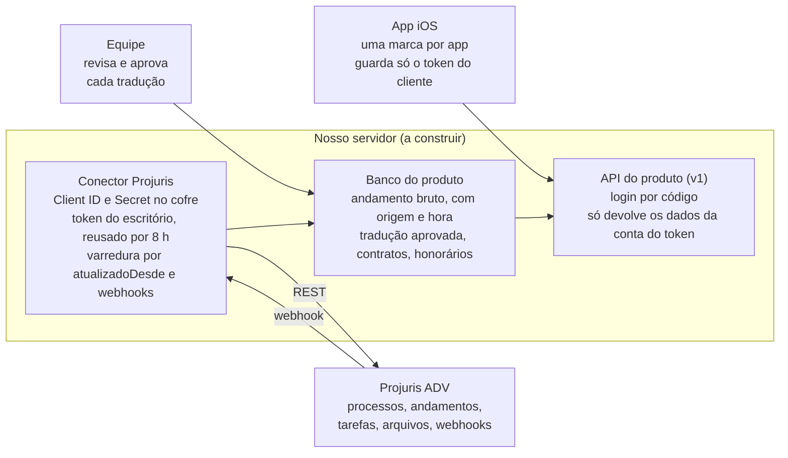

# Conectar o Projuris ADV ao app

Roteiro de execução · 11/11/2026. O desenho completo está em [camada-de-servico.md](camada-de-servico.md).

## Resumo

O app nunca fala com o Projuris: ele fala com a API do produto, e um conector no servidor fala com o Projuris. O lado do app já está pronto; falta construir o backend e o conector, e depois trocar uma linha no `Brand.json`.

A regra que define tudo: o Client ID e o Client Secret do Projuris abrem a carteira inteira do escritório, de todos os clientes. Eles ficam só no servidor. Se forem para dentro do app, qualquer cliente que instalar consegue extraí-los.

## Antes de começar

No Projuris, o escritório precisa ter três coisas prontas. Sem elas a API responde 401 ou volta vazia.

- [ ] **API contratada no plano.** Sem isso a aba Integração API nem aparece.
- [ ] **Credenciais geradas por um administrador** em Perfil → Dados da Conta → Integração API. O Client ID tem o formato `api_cliente_codigo_{código do escritório}`; o Client Secret aparece mascarado e tem botão de copiar.
- [ ] **Usuário da integração definido** na mesma tela. A integração herda as permissões dele e a auditoria registra tudo em nome dele. Use um usuário dedicado, que não seja administrador nem usado por uma pessoa. Sem ele, toda chamada volta 401.
- [ ] **Módulo de Webhooks** (opcional, contratado à parte com o comercial do Projuris). Ajuda a saber quando um processo muda, mas não cobre andamentos.

Do nosso lado, duas decisões travam o resto:

- [ ] **Existe backend?** Sem um servidor, nenhuma marca sai do modo demonstração com dados reais.
- [ ] **Onde a equipe escreve a tradução** de cada andamento: num painel nosso ou num campo dinâmico do próprio Projuris.

As credenciais vão para o cofre de segredos do servidor, uma por escritório. Nunca em repositório, `Brand.json` ou e-mail.

## Arquitetura

São três camadas, e só a do meio falta construir: o app já está pronto e o Projuris já existe.



O app conversa apenas com a API do produto. O conector é o único que conhece a credencial do Projuris, faz as chamadas REST e recebe os webhooks. Para trocar de provedor, troca-se o conector; o app não muda.

## Autenticação no Projuris

O conector pede um token com as credenciais do escritório e o reutiliza por até 8 horas. A própria documentação pede para não gerar token a cada chamada.

| Item | Valor |
| --- | --- |
| Endereço do token | `POST https://apigw.projurisadv.com.br/auth/token` |
| Corpo | `x-www-form-urlencoded`: `grant_type=client_credentials`, `client_id`, `client_secret` |
| Validade | `expires_in` = 28800 s (8 h) |
| Endereço dos serviços | `https://api.projurisadv.com.br/adv-service/` |
| Cabeçalhos das chamadas | `Authorization: Bearer {access_token}` e `Accept: application/json` |
| Limite | por escritório; excedido → `429` com `Retry-After` |
| Cache do Projuris | algumas consultas vêm de cache por até 10 min (`X-Cache: HIT`) |

Como o conector deve se comportar:

1. Guardar o token por escritório, em memória, e renovar uns 5 minutos antes de vencer.
2. Em `401`, renovar uma única vez e repetir a chamada. Segundo `401` seguido é problema de configuração (ver Problemas comuns), não de token.
3. Em `429`, esperar o `Retry-After` e reduzir o ritmo da varredura daquele escritório.
4. Nunca registrar token, Client Secret ou corpo de resposta em log.

A resposta do token também traz `refresh_token` (30 min). Com `client_credentials` é mais simples pedir um token novo do que usar o refresh.

## Mapeamento Projuris → app

Processos, andamentos, audiências e arquivos vêm do Projuris; tradução, contratos com vencimento e honorários não existem na API e moram no nosso banco. Todo registro guarda a origem (`projuris` + código), e o app só recebe os nossos identificadores.

| No app | No Projuris | Como mapear |
| --- | --- | --- |
| Conta (empresa ou pessoa) | `GET pessoa/consulta?filtro-geral={CNPJ ou CPF}` | O documento casa o cliente; guardar o `codigoPessoa`. CPF (11 dígitos) vira conta de pessoa física no app. |
| Processo | `POST processo/consulta-completa` com `codigoPessoaEnvolvido` e `atualizadoDesde` | `processoNumeroWs` com `principal: true` → número CNJ; `segredoJustica` → sob sigilo; `situacaoProcesso` → aberto ou encerrado; `responsaveis[0]` → advogado. |
| Parte contrária | página "Processos / Envolvidos" | A confirmar: essa página da documentação ainda não foi lida. |
| Andamento | `GET processo/{codigo}/andamento/consulta` | `descricaoAndamento` → texto oficial. `privado: true` nunca sai do servidor. Sem tradução aprovada, não é publicado. |
| Audiência e prazo | `GET processo/{codigo}/tarefa/consulta-multi-modulo` | `compromisso`, `dataLimite`, `horaLimite`, `local`; `checklistWs` → "Leve com você". |
| Confirmar presença | `PUT tarefa` (situação) ou um andamento novo | Decidir com o escritório qual dos dois é o registro oficial. |
| Documentos do processo | `GET processo/{codigo}/arquivo/` | Link para abrir: `GET …/arquivo/visualiza/{codigoArquivo}`, gerado no servidor na hora. |
| Envio de arquivo | `POST arquivo` em multipart, com o arquivo `modulos_vinculo` | O app manda o arquivo inteiro para a nossa API; o conector repassa. |
| Contrato com vencimento e pontos de atenção | não existe | Nosso banco, cadastrado pela equipe. A página "Contratos" da documentação é a lista de tipos de dados, não uma entidade. |
| Honorários | webhook de Receitas | Não há consulta documentada; guardar o que o webhook enviar. |

Três detalhes que causam bug se esquecidos:

- **Datas** vêm em milissegundos desde 1970 (`1544580000000`), não em ISO 8601. Converter no fuso `America/Sao_Paulo`.
- **Paginação** por `quan-registros` e `pagina`; a resposta traz `totalRegistros`.
- **Valores de lista** (situação, tipo de justiça, órgão) vêm como `{chave, valor}`; guardar a chave, nunca o texto.

## Sincronização

Andamentos chegam por varredura periódica, porque o Projuris não tem webhook de andamento. Os webhooks servem para saber quais processos mudaram e para receber honorários.

O caminho de um andamento, do Projuris até o cliente:

1. A varredura pede `processo/consulta-completa` com `atualizadoDesde` = hora da última varredura bem-sucedida daquele escritório.
2. Para cada processo alterado, busca os andamentos e grava **o texto bruto**, com origem e hora de chegada. Nada é apagado: é o que permite trocar de fornecedor sem perder histórico.
3. Andamento novo entra na fila de tradução, com um rascunho automático do texto e um palpite de "exige o cliente?".
4. Alguém do escritório corrige e aprova. Só então o andamento é publicado (quem aprovou, quando).
5. Publicado e "exige o cliente": gera push, no máximo um por processo por dia. O resto entra só na lista "Para saber".

Webhooks disponíveis no Projuris:

| Categoria | Eventos | Uso aqui |
| --- | --- | --- |
| Processos | cadastro, atualização, exclusão, encerrar | Disparar a varredura daquele processo na hora; marcar encerrado. |
| Receitas | cadastro, atualização, exclusão, estorno | Alimentar "Honorários" no Perfil. |
| Despesas | cadastro, atualização, exclusão, estorno | Não usado. |
| Solicitações | cadastro, atualização, exclusão, integrada, recusada | Não usado por enquanto. |

Cuidados com webhook:

- O mesmo evento pode chegar mais de uma vez (o Projuris avisa que POST não é idempotente). Guardar o identificador de cada evento e ignorar repetidos.
- Proteger o endereço com um cabeçalho secreto, cadastrado em "Cabeçalhos personalizados".
- Processo encerrado sem número CNJ não dispara "encerrar": a varredura continua necessária.

A frequência da varredura não está definida; uma vez por hora em horário comercial é um ponto de partida que respeita o limite de requisições.

## Contrato com o app (v1)

O app já sabe chamar estas oito rotas; o backend precisa responder exatamente assim. Estão em `AdvClient/Core/Services/Remote/BackendAPI.swift`, e os testes em `ServiceLayerTests.swift` mostram um snapshot completo de exemplo.

| Rota | Para quê | Resposta |
| --- | --- | --- |
| `POST /v1/auth/code` `{email}` | Pede o código de 6 dígitos | `{expiresAt, resendAllowedAt}` |
| `POST /v1/auth/session` `{email, code}` | Troca o código por sessão | `{token, expiresAt, company}` |
| `DELETE /v1/auth/session` | Encerra a sessão | vazio |
| `GET /v1/snapshot` | Tudo o que o cliente vê | o snapshot |
| `POST /v1/cases/{id}/hearing/confirmation` | Confirma presença | o snapshot atualizado |
| `POST /v1/pendencies/{id}/resolution` | Resolve pendência | o snapshot atualizado |
| `POST /v1/documents?fileName&caseId` | Envia arquivo (corpo cru) | o snapshot atualizado |
| `POST /v1/events/whatsapp-handoff` `{caseId}` | Registra a saída para o WhatsApp | vazio |

Regras de formato que o app cobra:

- **Datas** em ISO 8601 (`2026-11-14T13:00:00Z`). O conector converte os milissegundos do Projuris.
- **Dinheiro** como texto decimal (`"84200.00"`), nunca número com vírgula flutuante.
- **Listas** (área, risco, tipo de documento, tipo de pendência) como texto. Valor desconhecido não derruba o app, mas área nova aparece como "Outros".
- **Só andamento publicado** vai no snapshot. O app confere de novo e esconde o que vier sem tradução e aprovação.
- **`capabilities`** `{documents, uploads}` liga ou esconde a aba Documentos e o envio. Ausente = tudo ligado.
- **Isolamento:** o snapshot não recebe id de empresa. O servidor sabe de quem é o token e só devolve o que é dessa conta.

Erros seguem `{code, detail, requestId}`. O app mostra frase própria, nunca o `detail`. Códigos que ele reconhece no login: `unknown_email`, `invalid_code`, `code_expired`, `malformed_email`. Qualquer `401` fora do login devolve o cliente à tela de entrada.

## Ligar o app

No app, ligar a API é trocar duas linhas no `Brand.json` da marca; nenhuma tela muda.

```json
"api": {
  "baseURL": "https://api.seuproduto.com.br",
  "mode": "remote"
}
```

1. **Endereço:** `baseURL` precisa ser `https`. Com endereço inválido o app não cai nos dados de demonstração: toda chamada falha com mensagem genérica, de propósito.
2. **Bloco `demo`:** em `remote` ele é ignorado. Pode ficar, mas o `Brand.json` vai dentro do app: tire o e-mail pessoal antes de publicar se não quiser que ele fique legível no pacote.
3. **Conta de revisão da Apple:** o login é por código no e-mail e o revisor não recebe esse e-mail. O backend precisa aceitar um e-mail de revisão com código fixo, ligado a uma conta com dados fictícios. Os dois vão nas notas para o revisor.
4. **Rede no aparelho:** o app só aceita HTTPS com certificado válido e transparência de certificado (já configurado no `Info.plist`). Certificado autoassinado não funciona nem em teste.

No App Store Connect, quando a marca passar a usar dados reais:

- [ ] Atualizar os rótulos de privacidade: e-mail, conteúdo enviado pelo usuário e interação com o app, ligados à identidade, sem rastreamento. O `PrivacyInfo.xcprivacy` do app já declara isso.
- [ ] Confirmar a declaração de criptografia (`ITSAppUsesNonExemptEncryption`). O app só usa HTTPS e a segurança do sistema; o normal é `NO`, mas a declaração é do escritório.
- [ ] Revisar a política de privacidade do escritório (o link é obrigatório no App Store Connect) para cobrir os dados reais que o app passa a mostrar.

## Checklist de testes e produção

Teste primeiro com uma conta de escritório de homologação e um cliente de teste no Projuris, nunca com a carteira real.

**Conector**

- [ ] Token é gerado uma vez e reaproveitado; renova antes das 8 h.
- [ ] Um cliente só enxerga os próprios processos (testar com dois clientes do mesmo escritório).
- [ ] Andamento `privado` nunca aparece no snapshot.
- [ ] Andamento sem tradução aprovada não aparece no app.
- [ ] Processo em segredo de justiça aparece com o aviso próprio e sem linha do tempo.
- [ ] Datas batem com o Projuris no fuso de São Paulo (conferir uma audiência às 14h30).
- [ ] Webhook repetido não duplica nada.
- [ ] Excesso de chamadas: `429` é respeitado e a varredura desacelera.

**App, com `"mode": "remote"`**

- [ ] Login com e-mail convidado, código errado e código vencido mostram a frase certa.
- [ ] Confirmar presença e enviar arquivo chegam ao Projuris; em falha, o app oferece "Tentar de novo".
- [ ] Sem rede: o aviso de falha aparece com a data dos dados mostrados.
- [ ] Token revogado no servidor: o app volta para o login.
- [ ] Sair da conta e entrar com outra não mostra dado da anterior.
- [ ] `python3 scripts/verificar.py` sem falhas e o aviso de modo `demo` sumiu para a marca.
- [ ] Build em Release antes do archive (comando no README).

**Entrada em produção**

- [ ] Credenciais de produção no cofre do servidor, não as de homologação.
- [ ] Conta de revisão da Apple funcionando, com dados fictícios.
- [ ] Equipe treinada na fila de tradução: sem ela o app fica vazio, porque nada é publicado.
- [ ] TestFlight com o escritório antes de liberar na loja.

## Problemas comuns

| Sintoma | Causa provável | O que fazer |
| --- | --- | --- |
| Toda chamada volta `401`, mesmo com token novo | Usuário da integração não definido | Administrador define em Dados da Conta → Integração API → Usuário da integração. |
| Token deixou de ser aceito de repente | Alguém clicou em "Gerar nova chave": a anterior morre na hora | Atualizar o Client Secret no cofre do servidor. |
| Chamadas funcionam mas voltam vazias ou incompletas | O usuário da integração não tem permissão naqueles processos | Ajustar o perfil desse usuário no Projuris. |
| `429 Too Many Requests` | Limite do escritório estourado | Esperar o `Retry-After`; espaçar a varredura; nunca gerar token por chamada. |
| Alteração feita no Projuris não aparece | Resposta veio do cache do Projuris (`X-Cache: HIT`, até 10 min) | Aguardar; não é erro. |
| Horário da audiência uma hora errado | Data em milissegundos convertida no fuso do servidor | Converter sempre em `America/Sao_Paulo`. |
| Cliente vê processo mas a linha do tempo vazia | Andamentos ainda na fila de tradução | Comportamento esperado: só aparece depois de aprovado. |
| App mostra "não foi possível carregar" em tudo | `baseURL` inválido ou sem `https` no `Brand.json` | Corrigir o endereço; o app não cai na demonstração de propósito. |

## Decisões em aberto

Cinco decisões precisam do escritório antes de o conector ficar completo:

- [ ] Onde a equipe escreve a tradução e o "exige o cliente?": painel nosso ou campo dinâmico (`campoDinamicoDadoWs`) no Projuris.
- [ ] De onde vêm os contratos com vencimento e pontos de atenção, já que o Projuris não os expõe.
- [ ] Como confirmar presença: concluir a tarefa da audiência ou registrar um andamento.
- [ ] Frequência da varredura de andamentos.
- [ ] Ler a página "Processos / Envolvidos" da documentação para mapear a parte contrária.

No app, o que ainda falta e será preciso com dados reais:

- **Renovação de token:** hoje, token vencido devolve o cliente ao login.
- **Push:** registrar o token de notificação do aparelho no backend (cada marca tem a própria chave APNs).
- **Aviso de dado antigo:** mostrar "sem conexão · dados de …" quando o snapshot vier do cache vencido.
- **Barra de envio real:** hoje o progresso do upload é indicativo.
- **Pinning de certificado:** depende das chaves do servidor; é o item que mais pesa numa auditoria de segurança.

## Fontes

Documentação técnica do Projuris ADV, lida em 09/11/2026:
[Integrações API](https://ajuda.projurisadv.com.br/space/BDC/1114969) ·
[Token de integração](https://ajuda.projurisadv.com.br/space/BDC/649658384) ·
[Login — obter token](https://ajuda.projurisadv.com.br/space/BDC/1117904) ·
[Processos](https://ajuda.projurisadv.com.br/space/BDC/1115014) ·
[Andamentos](https://ajuda.projurisadv.com.br/space/BDC/1115491) ·
[Arquivos](https://ajuda.projurisadv.com.br/space/BDC/1115519) ·
[Tarefas](https://ajuda.projurisadv.com.br/space/BDC/1115689) ·
[Pessoas](https://ajuda.projurisadv.com.br/space/BDC/1115694) ·
[Webhook: cadastro e listagem](https://ajuda.projurisadv.com.br/space/BDC/480542727)
